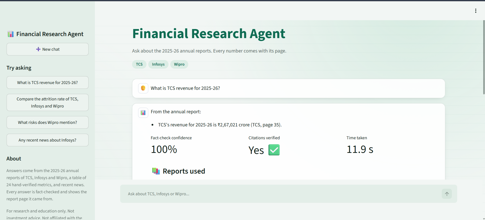
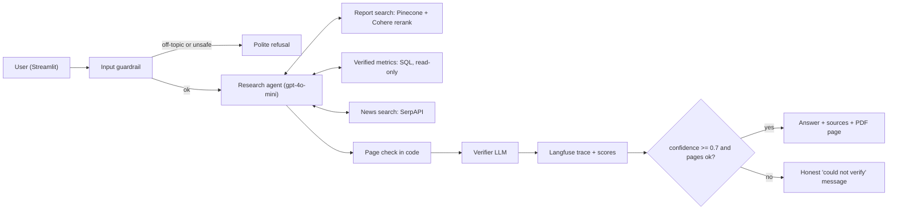
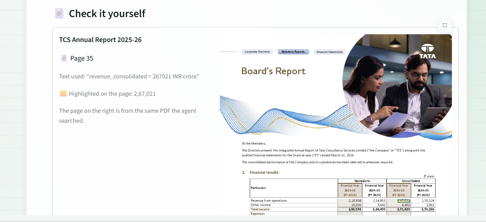

# Financial Research Agent

Ask questions about the **2025-26 annual reports of TCS, Infosys and Wipro**. Every number comes with the page it was found on, and every answer is fact-checked before it is shown.



## Results

| | |
|---|---|
| Evaluation questions passed | **20 / 20** (facts, open questions and refusals) |
| Citations on the correct page | **14 / 14** |
| Metrics checked by hand against the PDFs | **24**, with 8 extraction errors found and fixed |
| Off-topic or harmful questions | blocked in about **2 seconds**, before the agent runs |

## How it works



1. **Guardrail:** blocks jailbreaks, personal data, secret keys, harmful requests, investment advice and anything not about the three companies.
2. **Agent:** picks the right tool:
   - **SQL** for the 8 headline numbers (revenue, profit, margin, EPS, dividend, employees, women %, attrition)
   - **report search** for everything else
   - **news search** only for recent news
3. **Checks:** code confirms every cited page was really retrieved, then a second model checks every fact against the sources. Low-confidence answers are never shown.
4. **UI:** shows the fact-check confidence, the cited pages and the **real report page with the number highlighted**, so anyone can check the answer themselves.



## Tech stack

| Part | Tools |
|---|---|
| Ingestion | Python, pdfplumber, OpenAI `text-embedding-3-small` |
| Search | Pinecone (vector search), Cohere (rerank) |
| Agent and workflow | n8n, OpenAI `gpt-4o-mini`, n8n Guardrails node |
| Exact numbers | Neon Postgres (read-only role and view) |
| News | SerpAPI (Google News) |
| Monitoring | Langfuse (OpenTelemetry traces and scores) |
| UI | Streamlit |

## Key design decisions

- **Chunks never cross a page** (300 words, 50-word overlap), so every answer can cite a real page number.
- **Fetch 20 results, rerank to 5.** Plain vector search found the topic but missed exact facts such as the TCS headcount.
- **Exact numbers come from a hand-verified SQL table**, not from search. The agent's database user can only read one view.
- **Page numbers are checked in code, facts by a second model.** Code is exact and free; the model judges meaning.
- **The guardrail fails closed:** if the guard model errors, the question is refused, never let through.

## Problems I solved

| Problem found in testing | Fix |
|---|---|
| The model wrote "(Company, page X)" literally | A real example in the prompt. Models copy examples better than they follow rules. |
| The same answer scored 1.0, then 0.4 | The verifier was reading raw tool JSON; a code node now builds clean, labelled sources |
| Answers cited pages from another company | Company name in every search plus a metadata filter on company |
| 8 wrong metric values (million vs crore, partial dividends) | Every value checked by hand against the PDF |
| The agent added its own opinions ("this strategy is effective") | A no-opinions rule, and the verifier caps such answers at 0.5, so they are withheld |
| A 40% answer reached the user | A lost confidence condition in the gate, restored and tested |

## Project structure

```
app/            Streamlit chat UI
ingestion/      1_extract_text -> 2_chunk_text -> 3_embed_upload
n8n/            agent workflow and metrics-setup workflow (exported JSON)
prompts/        agent, verifier and guardrail prompts
eval/           test set, evaluation script, latest results
docs/           setup guide, metrics verification, screenshots
scripts/        n8n start script, search test
```

## Run it

See [docs/SETUP.md](docs/SETUP.md). In short: run the 3 ingestion scripts, import the n8n workflow and add your credentials, then `streamlit run app/streamlit_app.py`.

## Limitations

- Covers 3 companies and one report year.
- The verifier is also a language model, so it can occasionally be wrong; the code page check and the evaluation set reduce this risk.
- An answer takes about 8–15 seconds.
- It runs in Codespaces and is not deployed publicly.

---

<sub>For research and education only. Not investment advice. Not affiliated with the companies mentioned. The annual reports belong to their companies and are not included in this repository.</sub>
